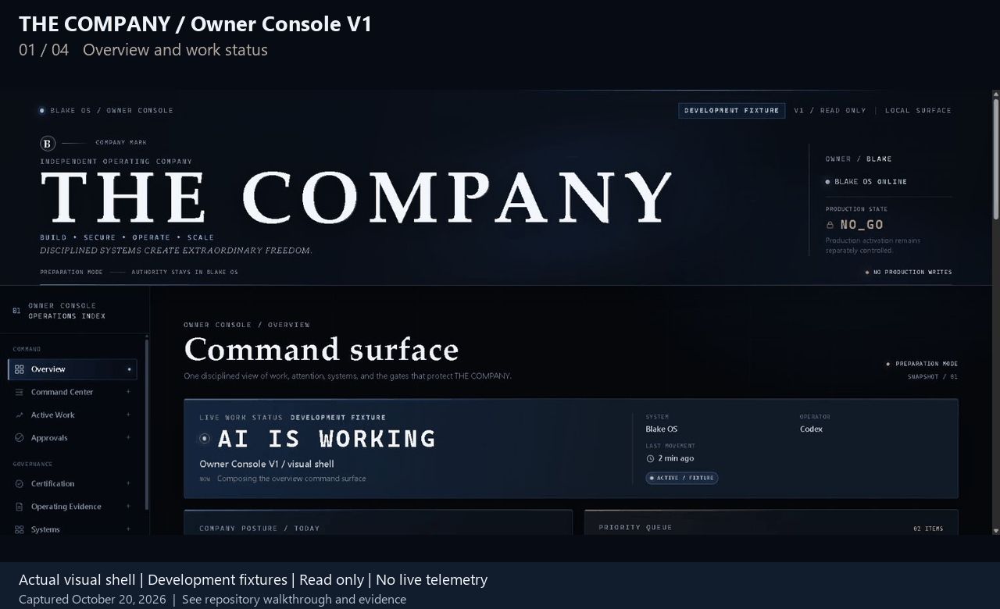

# Company OS Case Study

**Human-controlled AI workflow orchestration.**

*Actual THE COMPANY / Owner Console V1 interface, captured October 20, 2026. Read-only visual shell with development fixtures; live telemetry and integrated execution are not shown.*

Business work often crosses projects, tools and sessions. A request needs an owner, a bounded execution scope, evidence and a reviewable handoff. THE COMPANY / Owner Console V1 provides a local interface for that architecture: work status, owner attention, governance gates, systems and a command preview. The captured Phase 1 build uses visibly labeled development fixtures.

*Actual app screen. DEVELOPMENT FIXTURE, READ ONLY and NO_GO describe the captured visual-shell mode.*

**Status:** Actual Owner Console V1 visual shell; development fixtures; private components; integrated readiness not established.

[Walkthrough](docs/WALKTHROUGH.md) · [Technical explanation](docs/ARCHITECTURE.md) · [Validation scope](docs/EVIDENCE.md)

## From input to output

Consider a request to prepare a support-workflow change. Project context identifies the responsible project; a bounded worker prepares the change and its evidence; retrieval can supply supporting documentation; the output returns for review. Publication or production action still requires the applicable human authorization. This example explains the intended flow, not a newly verified integrated run.

## My contribution

I designed the responsibility boundaries, project routing model and review process, and directed AI-assisted implementation of the component systems. My contribution includes workflow decisions, scope definition, review and operational ownership. Agent-run checks provide evidence for named components rather than proving that I personally executed every test.

## Architecture and decisions

The operating layer preserves canonical project state and recovery evidence. Project OS uses versioned request and receipt contracts to route bounded work. Worker environments, specialist domains, knowledge retrieval and proposed learning have separate responsibilities. Security and independent verification cut across those responsibilities. The Owner Console supplies the interface shown here. Its captured READ_ONLY_VISUAL_SHELL build is separate from live telemetry, command routing and the underlying systems.

- Separate routing from execution: a route identifies ownership without granting a worker blanket authority. More contracts are required, but failures can be traced to a narrower boundary.
- Separate evidence from authorization: a cited answer or passing test supports a decision but cannot approve spending, publication or a production write.
- Promote learning explicitly: proposed lessons can be reviewed without silently rewriting canonical operating rules. This limits automatic adaptation and preserves owner control.

## Validation

On October 20, 2026, the existing Phase 1 Owner Console build was opened locally and its overview, work/review, governance/systems and command-preview panels were captured. These are actual interface screenshots of development fixtures. No source implementation was changed, no command was dispatched and no live integration was established. [Capture details](docs/interface-captures.json).

The refreshed case study is based on read-only inspection of the public presentation and relevant local operating/routing contracts. Project OS exposes DRY_RUN_ONLY routing and supervised, disposable-target boundaries. The operating repository explicitly reports a NO_GO production state. The inspection report is current source-contract evidence, not an end-to-end runtime demonstration or whole-system certification.

## Failure and human review

Missing scope, inconsistent evidence and incomplete review must remain visible. A handoff retains source identity, outstanding checks and the next permitted step. A worker cannot infer authorization from a successful test. The public presentation does not contain credentials, internal prompts or private operating instructions.

## Limitations

Component readiness and integrated readiness are separate. Source inspection does not establish live adapter health, recovery across every subsystem or production adoption. The architecture remains under development. No new integrated run, scheduler activation or production migration was performed for this showcase.

## Inspect or run

Read the input-to-review walkthrough, source-inspection report and architecture diagram. The implementation repositories remain private. There is no public installation command for the complete architecture.
