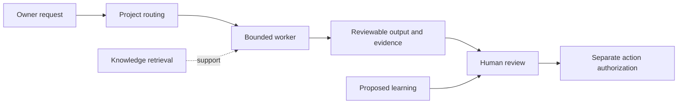

# Company OS Case Study: architecture

The operating layer preserves canonical project state and recovery evidence. Project OS uses versioned request and receipt contracts to route bounded work. Worker environments, specialist domains, knowledge retrieval and proposed learning have separate responsibilities. Security and independent verification cut across those responsibilities. The Owner Console supplies the interface shown here. Its captured READ_ONLY_VISUAL_SHELL build is separate from live telemetry, command routing and the underlying systems.

- Separate routing from execution: a route identifies ownership without granting a worker blanket authority. More contracts are required, but failures can be traced to a narrower boundary.
- Separate evidence from authorization: a cited answer or passing test supports a decision but cannot approve spending, publication or a production write.
- Promote learning explicitly: proposed lessons can be reviewed without silently rewriting canonical operating rules. This limits automatic adaptation and preserves owner control.

This diagram is a conceptual architecture visual, not a runtime screenshot.

