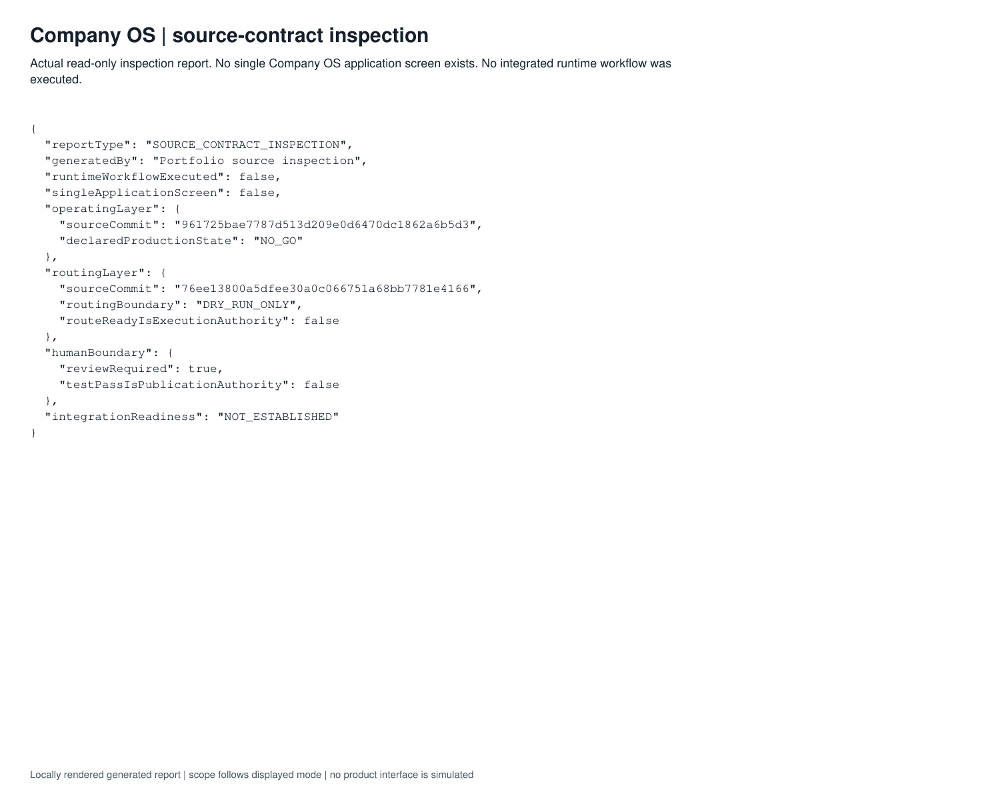
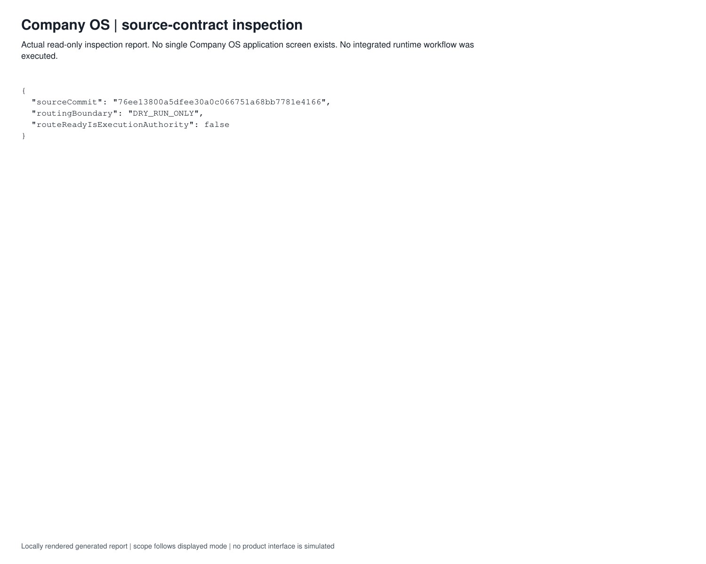
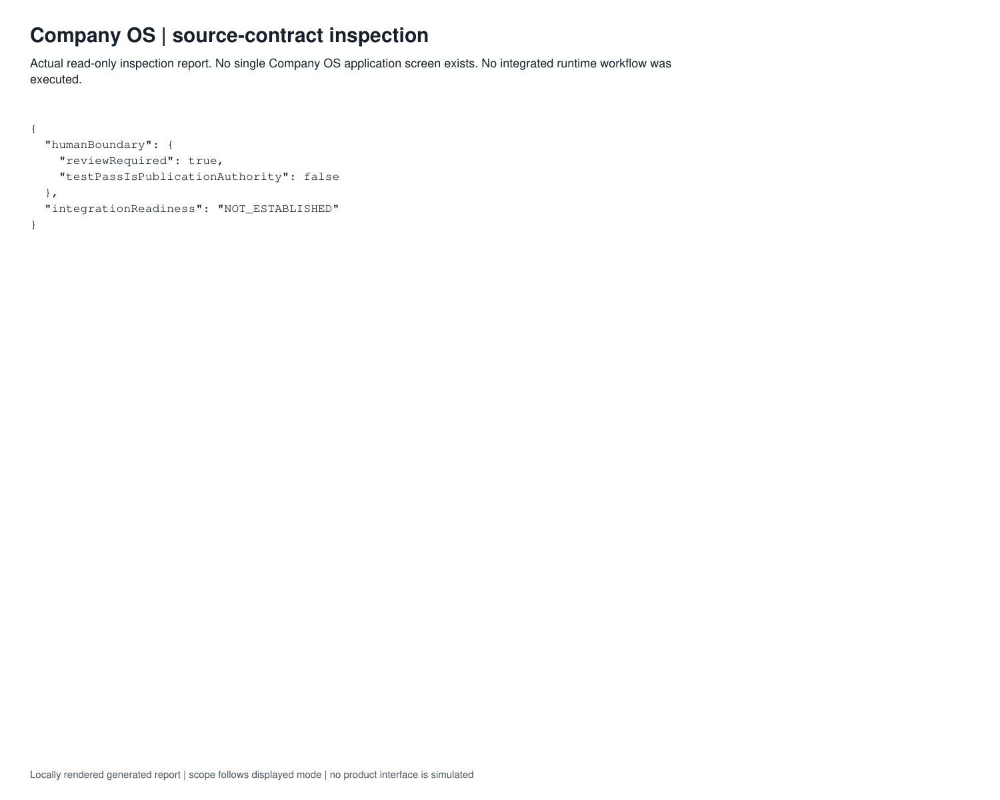

# Demonstrated scope

The refreshed case study is based on read-only inspection of the public presentation and relevant local operating/routing contracts. Project OS exposes DRY_RUN_ONLY routing and supervised, disposable-target boundaries. The operating repository explicitly reports a NO_GO production state. The inspection report is current source-contract evidence, not an end-to-end runtime demonstration or whole-system certification.

Component readiness and integrated readiness are separate. Source inspection does not establish live adapter health, recovery across every subsystem or production adoption. The architecture remains under development. No new integrated run, scheduler activation or production migration was performed for this showcase.

## Capture labels

Locally rendered genuine output report; this is not an application UI screenshot. Read its scope and limitations below.

*Locally rendered genuine output report; this is not an application UI screenshot. Read its scope and limitations below.*

*Locally rendered genuine output report; this is not an application UI screenshot. Read its scope and limitations below.*

*Locally rendered genuine output report; this is not an application UI screenshot. Read its scope and limitations below.*

The figures are evidence for the described inputs and version only. No badge, production adoption or business-impact claim is inferred.

## Inspect complete reports

- [Complete company overview report](../assets/company-overview.pdf) · [JSON](./company-overview.json)
- [Complete company review report](../assets/company-review.pdf) · [JSON](./company-review.json)
- [Complete company routing report](../assets/company-routing.pdf) · [JSON](./company-routing.json)
