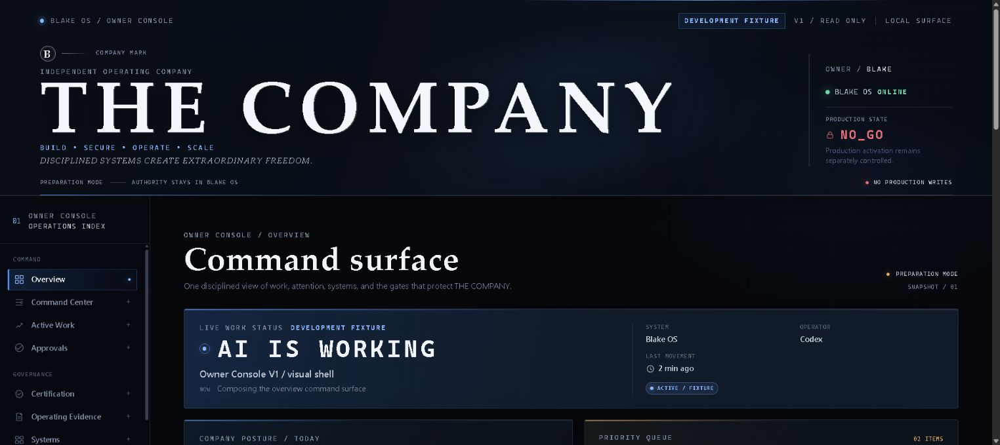
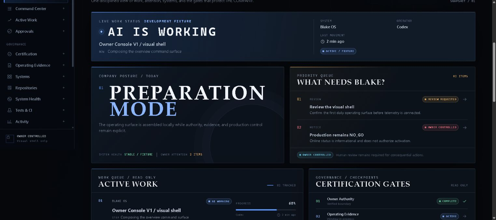
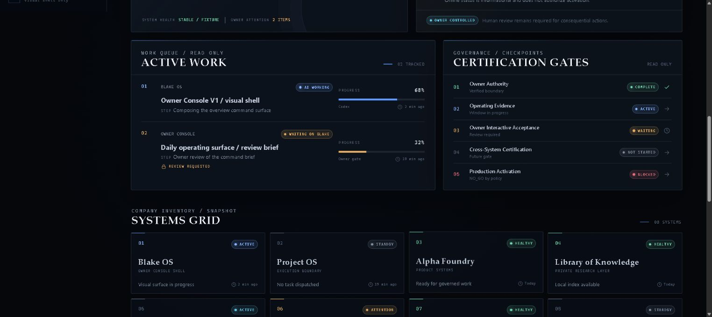
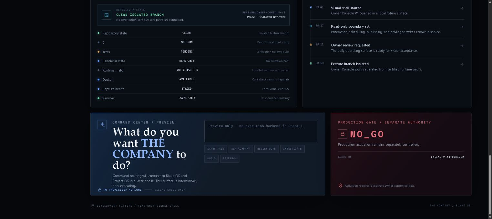

# THE COMPANY / Owner Console V1: interface walkthrough

The actual THE COMPANY / Owner Console V1 Phase 1 visual shell was captured locally on October 20, 2026. Its DEVELOPMENT FIXTURE and READ ONLY labels remain visible. Displayed tasks, health values, status labels and progress are fixtures, not measured live operation. Production remains NO_GO in this view. Navigation preview items and the disabled command area do not prove routing or execution.

1. **Overview and work status**: inspect the captured interface state and its visible mode labels.
2. **Work queue and owner attention**: inspect the captured interface state and its visible mode labels.
3. **Governance gates and systems**: inspect the captured interface state and its visible mode labels.
4. **Command preview and production boundary**: inspect the captured interface state and its visible mode labels.

### Overview and work status

### Work queue and owner attention

### Governance gates and systems

### Command preview and production boundary

The GIF is a slideshow of captured interface states. It does not establish live backend or production integration. Earlier architecture and runner reports remain in [EVIDENCE.md](EVIDENCE.md).
